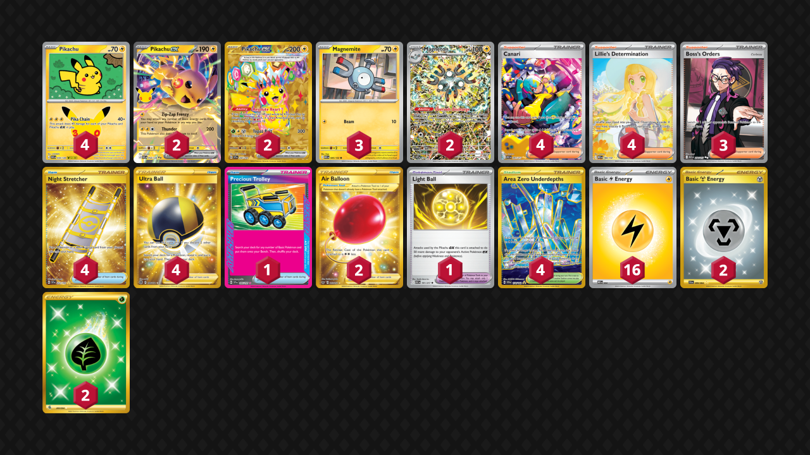

# Pikachu/Magneton

Tier **F** | Difficulty: **Moderate** | Gameplan: **Combo Midrange**

**Source**: DeepRootedTCG - [YouTube video](https://www.youtube.com/watch?v=MNz7vHDaN8w)

## List
* 3 Magnemite MEG 45
* 2 Magneton PR-SV 159
* 4 Pikachu 30C 34
* 2 Pikachu ex 30C 54
* 2 Pikachu ex SSP 247
* 3 Boss's Orders ASC 256
* 4 Night Stretcher SSP 251
* 4 Ultra Ball BRS 186
* 2 Air Balloon SSH 213
* 4 Area Zero Underdepths SCR 174
* 1 Light Ball ASC 191
* 4 Canari ASC 291
* 1 Precious Trolley SSP 185
* 4 Lillie's Determination MEG 184
* 16 Basic {L} Energy MEE 4
* 2 Basic {M} Energy SFA 99
* 2 Basic {G} Energy FST 283